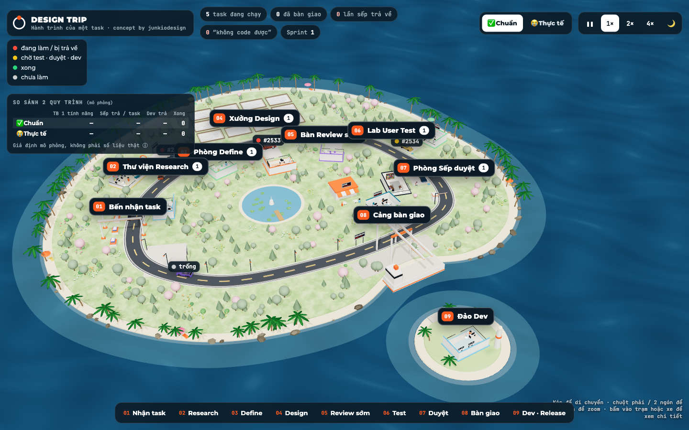

# Design Trip — bản đồ 3D hành trình của một task design



Concept của junkiodesign, dựng từ mô hình trong video TikTok "Hành trình 1 task design".
Mỗi siêu xe chở một designer cùng thẻ file thiết kế của một tính năng (thẻ nổi trên nóc xe) qua 8 phòng ban và đảo Dev:
Nhận task → Research → Define → Design → Review sớm → User test → Duyệt → Bàn giao → Đảo Dev (build, Design QA, release).

- **8 phòng ban** dựng kiểu cắt lớp (nhìn được vào trong): Product, Research, Define, Xưởng Design, Review sớm, Lab User Test, Phòng Sếp, Bàn giao, cùng văn phòng Dev trên đảo. Mỗi phòng có bàn, màn hình, dụng cụ riêng (kanban, kệ sách, moodboard, tường giấy note, design system, gương một chiều, checklist bàn giao…) và một **bot AI** lơ lửng kèm bảng hologram nói nó đang hỗ trợ việc gì. Nội dung trên hologram là minh hoạ.
- **Bãi đỗ ở mọi phòng ban**: Design (3 chỗ), Review sớm, User Test, Sếp duyệt, Bàn giao (2 chỗ mỗi phòng) có bãi đỗ nằm giữa đường và cửa phòng. Xe rẽ vào bãi, designer xuống xe, đi bộ vào phòng làm việc (thời gian làm việc chỉ tính khi đã ở trong phòng), xong thì đi bộ về xe rồi xe nhập làn đi tiếp. Bãi đầy thì xe xếp hàng ở lối vào. Ở bãi chờ task, designer vào Phòng Product ngồi chờ, có task thì đi ra xe. Ở bãi research, designer vào phòng Research, tới phần Define thì đi bộ sang Phòng Define bên kia đường. Bị sếp trả về hoặc góp ý sớm: xe lùi về quá lối vào Xưởng Design, chờ làn trống rồi chạy vào bãi để sửa.
- **Đảo QC + hải đăng release**: nối với đảo Dev bằng một cây cầu. Bản build (sau Design QA) chạy qua cầu sang phòng QC, tester chạy test case. Pass thì hải đăng sáng rực và bắn pháo hoa; có lỗi thì trả về dev sửa rồi test lại. Tỉ lệ QC báo lỗi (12%) là giả định mô phỏng.
- **Đảo User (thành phố)**: toà nhà cao tầng, văn phòng công ty, người đi bộ cầm điện thoại, màn hình "APP LIVE" ở quảng trường. Mỗi lần release, thẻ file bay từ hải đăng sang thành phố và số user tăng. Cứ 5 giây (thời gian mô phỏng) lại có một user báo lỗi: pháo sáng đỏ bắn lên từ toà nhà cao nhất, bảng cảnh báo trên đảo nhảy số ⚠, và tính năng đang live đó quay về backlog thành task hotfix 🩹; nếu không còn tính năng nào ổn thì user khác báo thêm vào lỗi đang mở. Lúc bắt đầu, F09–F12 đã live sẵn từ đợt release trước.
- **Quán cà phê ven đường**: nằm trên đoạn đường trống sau cảng bàn giao, có bãi đỗ 2 chỗ. Bàn giao xong, xe trống ghé quán: designer xuống xe, vào ngồi khoảng 10 giây rồi về xe, chạy tiếp về bến nhận task. Quán đầy thì xe chạy thẳng.
- **12 Agent ở Xưởng Design**: mỗi tính năng F01–F12 có một bệ làm việc và một Agent AI riêng (Pixel, Grid, Kern, Hue, Flex, Vector, Nova, Bezier, Glyph, Layer, Frame, Mono). Chưa làm: Agent ngồi sạc. Đang làm: Agent bay trên khung, chiếu tia vẽ UI phủ dần lên wireframe. Chờ duyệt / dev / QA / QC: Agent quét soát. Đã live: Agent nhảy mừng. User báo lỗi: Agent và khung nháy đỏ. Thẻ của mỗi Agent (có thanh tiến độ) chỉ hiện khi zoom vào khu Xưởng Design; bấm vào thẻ hoặc Agent để xem chi tiết. Ban đêm 6 cột đèn pha và 2 đèn lớn chiếu sáng cả khu, khung vẽ phát sáng như màn hình nên các Agent vẫn làm việc.
- **GAME ZONE** cạnh quán cà phê: nhà game có 4 máy arcade, máy gắp thú, ghế lười và vòng đu quay. Bấm vào khu này để chọn và chơi mini game ngay trên trang: Bắt Bug, Căn Pixel, Lật Thẻ Icon, Đoán Mã Màu. Kỷ lục lưu trên trình duyệt.
- **Hòn đảo**: cỏ, đường nhựa có vỉa hè, hàng cọ và ô che nắng trên bãi biển, đá ven bờ, vùng nước nông màu ngọc với bọt sóng, luống hoa, hồ sen có đài phun nước.
- **Bản đồ tổng quan**: toàn đảo nhìn chéo từ trên, nhãn trạm, xe, 12 ô artboard tính năng (chấm đỏ / vàng / xanh), bảng tin sự kiện.
- **Chi tiết trạm**: bấm nhãn trạm, thanh bước ở dưới hoặc minimap → camera bay tới, bảng bên phải: mô tả, task đang ở trạm, khó khăn, mẹo.
- **Theo dõi xe**: bấm vào xe hoặc thẻ #task → camera bám theo, xem lịch sử của task (số lần sếp trả về, số version).
- Bến nhận task có **nhà xe** 4 chỗ (bãi lộ thiên có trụ sạc, lùi xa khúc cua): xe trống quay về sẽ vào bãi đỗ, khi cẩu rảnh và còn tính năng chưa làm thì xe chờ lâu nhất ra nhận file trước. Bãi đầy thì xe xếp hàng trên đường.
- Thư viện Research có **bãi research** 3 chỗ: xe đỗ khoảng 30 giây (đếm ngược trên thẻ xe), xong thì ra đường đi vẽ. Bãi đầy thì xe xếp hàng ở lối vào.
- Sếp trả về → xe lùi bằng làn trái về Xưởng Design để sửa. Đủ file → tàu chạy ra đảo Dev, đôi khi file quay về với câu "không code được".
- **Quy trình** (9 bước + QC + User): Nhận task → Research → **Define** → Design (wireframe → UI → prototype) → **Review sớm PM + Dev** → User test → Duyệt → Bàn giao → Đảo Dev (build → Design QA) → Đảo QC → User. Góp ý nhỏ khi duyệt thì sửa rồi gửi lại, không test lại; task bị dev trả về không research lại.
- Điều khiển: tạm dừng (phím cách), 1× / 2× / 4×, ngày / đêm, Esc về bản đồ.

Dữ liệu task là ví dụ minh hoạ, chạy bằng mô phỏng trong trình duyệt (không có backend).

## Chạy thử

```sh
cd design-trip-web
python3 -m http.server 8140
# mở http://localhost:8140
```

Trang là HTML tĩnh (Three.js 0.169 từ jsDelivr), deploy được lên bất kỳ static host nào (Vercel, Netlify, GitHub Pages).

## File

- `index.html`, `style.css`: giao diện, thanh trên, bảng chi tiết, thanh bước, minimap
- `js/data.js`: nội dung các trạm và danh sách tính năng (sửa chữ ở đây)
- `js/world.js`: dựng đảo, đường vòng, các trạm, cây, đèn, tàu, đảo Dev
- `js/sim.js`: mô phỏng xe, cẩu, barie, tàu
- `js/main.js`: camera (bản đồ / chi tiết / theo dõi), nhãn, bảng, ngày đêm
